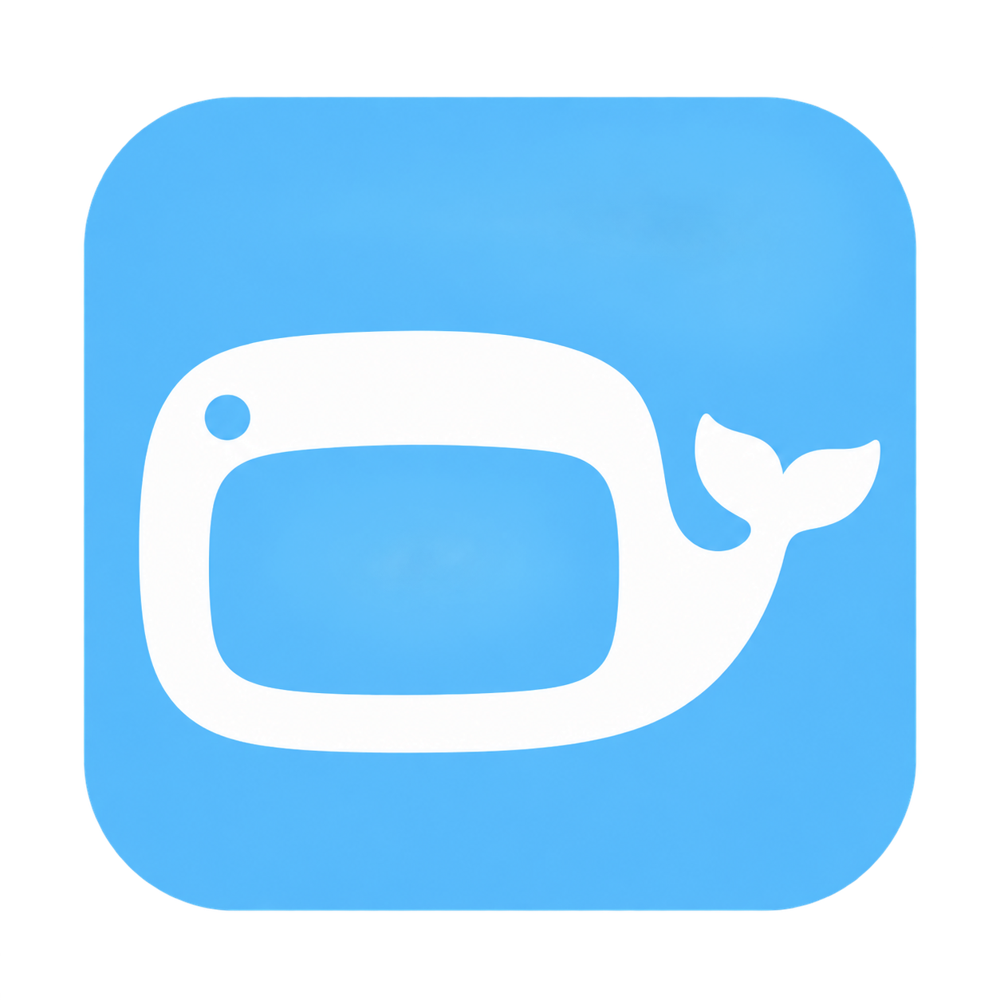

<p align="center">
  
</p>

# 鲸鱼电视

Windows 桌面版：WPF + WPF UI，LibVLC 直连播放，WebView2 官方页面取流 / 官网播放。深灰界面、蓝色焦点、频道抽屉、收藏、全屏、设置与脱敏诊断。版本 0.1.6。

## 平台

| 平台 | 版本 | 技术栈 | 最低系统 |
|---|---|---|---|
| Windows | 0.1.6 | WPF + WPF UI、LibVLC、WebView2 | Windows 10 1809 / 11 x64 |
| Android | 0.1.0 | Java、Media3（ExoPlayer）、WebView | Android 8.0（API 26） |

两个客户端是独立工程，频道目录分别维护，不共享代码。Windows 版说明见下文，Android 版另见 `android/README.md`。

## 运行

1. 使用 Windows 10（1809 或更新）/11 **x64**，解压整个 `WhaleTV-0.1.6-win-x64.zip`。
2. 打开文件夹内的 `鲸鱼电视.exe`。保留旁边所有文件和 `libvlc` 目录；不可只复制 exe。
3. 需要 Microsoft Edge WebView2 Evergreen Runtime。Windows 11 通常已安装；缺少时从微软官网安装：https://developer.microsoft.com/microsoft-edge/webview2/ 。包内已包含 .NET 运行时。
4. 默认进入浙江卫视。取流最长等待 35 秒；失败时点击“设置 → 重新取流并播放”或“改用内置官网播放器”。官网可能需要点击播放。

本包未进行代码签名。当前包在 macOS 交叉编译，尚未在 Windows 实机启动或播放；不等同于已验证稳定发布版。Windows 上可使用 .NET 10 SDK 执行 `powershell -ExecutionPolicy Bypass -File scripts/build-windows.ps1` 原生重新构建。

## 频道与行为

|频道|默认模式|
|---|---|
|浙江、江苏、东方卫视|加载官方公开网页，捕获当次正常会话的直播地址，再用 LibVLC 播放|
|CCTV-1～17、CCTV-5+、CGTN、各地卫视、CETV-1|内置央视频播放器，默认仅显示视频区域，保留播放器内官网提示|

每次换台重新取流，不生成签名，不持久化播放 token。江苏附带官网 Referer；东方使用获取播放地址时的同一 WebView2 User-Agent。此版本未实现自动过期续播；卡住时手动重试。官网页面改版、地域或账号限制可能影响播放，不绕过限制。

已适配官网模式默认显示视频区域，保持画面比例；应用按钮统一控制播放/暂停、音量、频道和窗口全屏。自动尝试播放并取消静音，若浏览器拒绝，点击底部“声音”重试。音量设置为 0 时保留静音。设置内“显示完整官网 / 恢复视频区域”可随时切回完整网页进行登录等操作。江苏卫视手动进入官网时保留原页面，尚未做视频区域适配。频道 01–87 是本应用排序，不是电视台官方编号。没有节目单、录制、频道管理或伪造的节目/画质信息。

## 操作

- `F11` 全屏；`Esc` 收起频道/退出全屏。
- `C` 频道；`←` / `→` 上下频道（也支持 `PageUp` / `PageDown`）。
- `↑` / `↓` 调整播放器音量；空格暂停/继续。
- `☆` 添加或移除当前频道收藏，频道抽屉中可筛选收藏。
- 已适配官网的快捷键转发给应用；完整官网或输入框获得焦点时，使用底部按钮。
- 所有频道的底部控制栏在停止操作 4 秒后自动隐藏；移动鼠标、按键、点击或滚轮操作会显示并重新计时。

设置及 WebView2 官网会话保存在 `%LOCALAPPDATA%\TVLive`。签名播放地址仅存在内存，诊断只含频道、时间和状态，不含 URL、Cookie 或令牌。设置页可导出日志。

## 项目结构

| 路径 | 内容 |
|---|---|
| `src/TVLive/` | Windows WPF 客户端：主窗口、设置、频道抽屉、官网适配脚本（`Web/*.js`）与图标资源 |
| `src/TVLive.Core/` | 跨平台频道目录与官方流地址白名单校验（`Channels.cs`，net10.0） |
| `tests/TVLive.Checks/` | 频道目录、地址白名单与频道边界的轻量检查 |
| `tests/TVLive.PackageChecks/` | 发布包依赖与文件完整性检查 |
| `tests/official-player/` | 官网播放器适配脚本的 jsdom 回归检查 |
| `android/` | Android 客户端 Gradle 工程 |
| `research/` | 取流与官网行为的验证脚本和结果，不是产品代码 |
| `design/` | 品牌图标方案与界面 mockup |
| `scripts/` | `build-windows.ps1` 打包脚本 |
| `dist/` | 本地构建产物，已被 `.gitignore` 排除 |
| `licenses/` | 第三方许可证原文 |

## Android 客户端

`android/` 是独立 Gradle 工程，包名 `cn.whaletv.mobile`（debug 构建为 `cn.whaletv.mobile.test`），版本 0.1.0，支持 Android 8.0（API 26）及以上。

- 8 个频道：浙江、江苏、东方、山东、湖南卫视，CCTV-1、CCTV-5、CCTV-13。
- 浙江 / 江苏 / 东方：WebView 加载官方公开页，识别匹配的 HTTPS HLS 地址后交给 Media3（ExoPlayer）播放；其余频道直接使用 WebView 官网页面。
- 触摸或按键唤醒控制栏，4 秒无操作自动隐藏；音量条调整系统媒体音量；进入后台暂停播放。
- 仅请求网络与网络状态权限，不请求摄像头、麦克风、位置或存储权限。

构建需要 JDK 17+、Android SDK Platform 35 / Build Tools 35.0.0、Gradle 8.11.1：

```sh
cd android
./gradlew assembleDebug testDebugUnitTest lintDebug
```

产物为 `android/app/build/outputs/apk/debug/app-debug.apk`。`local.properties` 中的 `sdk.dir` 需指向本机 SDK，或改用环境变量 `ANDROID_HOME`。

## 构建与测试

Windows 完整打包需在 Windows + .NET 10 SDK 上执行：

```powershell
powershell -ExecutionPolicy Bypass -File scripts/build-windows.ps1
```

脚本依次运行 `tests/TVLive.Checks`、发布到 `dist/WhaleTV-0.1.6-win-x64`、运行 `tests/TVLive.PackageChecks`，最后压缩为 zip 并附带 README、第三方声明与许可证。

单独执行检查：

```sh
dotnet run --project tests/TVLive.Checks
dotnet run --project tests/TVLive.PackageChecks -- dist/WhaleTV-0.1.6-win-x64
```

官网适配脚本回归（需要 Node.js 与 jsdom）：

```sh
cd tests/official-player
npm install
npm test
```

Android 单元测试与 lint 已包含在上面的 `./gradlew` 命令中。`android/validation.json` 记录 2 项单元测试通过、lint 0 错误 5 警告，播放与界面尚未真机验证。

构建产物输出到 `dist/`，该目录已被 `.gitignore` 排除。本机当前已有 `WhaleTV-0.1.6-win-x64.zip` 与 `WhaleTV-Android-0.1.0-test.apk`，各自附 `.sha256` 校验文件。

## Windows 实机验收（尚待执行）

- 首次启动默认浙江，确认画面、声音、窗口缩放和高 DPI。
- 浙江 → 江苏 → 东方各播放至少 60 秒；快速往返切换 10 次，确认只剩最后频道的声音和画面。
- 全屏时打开频道抽屉和设置，确认不被视频遮挡；双屏切换后再检查。
- 官网频道点击播放，换回卫视后确认没有后台双重声音。
- 改音量、收藏、上次频道和启动全屏，重启确认设置保存。
- 单频道连续播放 30 分钟，观察卡顿、签名失效；断网后重试。
- 关闭程序确认进程退出。失败时附频道、时间、具体表现及导出日志。

## 已完成检查

源码中的 10 项轻量检查覆盖官方流 URL 白名单、伪造域名、错误频道、非 HTTPS、频道边界与唯一 ID；这些不替代 Windows 播放测试。先前 macOS 流验证见 `research/README.md`，其成功不代表 Windows 本包已经通过实机验收。

构建：`dotnet publish src/TVLive/TVLive.csproj -c Release -r win-x64 --self-contained true -o dist/TVLive-win-x64`。

## 0.1.1 修复

修正 Windows 目标框架版本，补齐 WebView2CompositionControl 所需的 Microsoft.Windows.SDK.NET 与 WinRT.Runtime。错误弹窗显示缺失文件，详细异常保存在 `%LOCALAPPDATA%\TVLive\last-error.txt`。请完整解压新版本到独立文件夹运行。

## 0.1.2 修复

后台取流浏览器改为透明、不接收鼠标与焦点的 WPF 合成控件，取流结束隐藏，避免原生浏览器窗口遮挡直播。VLC 控制层使用固定容器，切换官网模式时移动容器内界面，避免控件父级残留。此修复已完成交叉编译与依赖校验，白块消失、按钮点击和官网来回切换仍需 Windows 实机验收。

## 0.1.3 统一观看体验

- 央视频 CCTV-1、CCTV-13、CCTV-5、湖南卫视按播放器 DOM 元素适配，无固定屏幕坐标。
- 视频容器撑满应用播放区域，保留原生播放器、登录和版权提示；不删除视频节点，不提取此类频道的独立播放地址。
- 模拟授权的播放操作，尝试开启声音；未成功时保留显式播放/声音按钮，不宣称一定可零点击自动播放。
- 设置可恢复完整官网。页面改版、权限或浏览器策略变化时，允许退回官网交互。
- 应用全屏控制窗口，不调用网页全屏按钮，避免页面独占全屏影响换台操作。

本轮验证：央视频当前 DOM 与真实静音按钮行为已检查；适配脚本 8 项 DOM 模拟检查通过（迟到视频、声音、暂停、快捷键、恢复、自动播放失败等），Windows 包依赖检查通过。DOM 模拟不代表 Windows 渲染或实机声音验收。请依次测试央视 1/13/5 与湖南，检查视频铺满、声音、音量、换台、F11 和完整官网恢复。

## 0.1.4 频道扩充与快捷键

初始扩充到 52：CCTV-1～17（含 CCTV-5+）、CGTN、32 个卫视频道及 CETV-1。新增入口来自 2026-10-24 央视频官网频道选择器，沿用视频区域与声音适配；原有浙江、江苏、东方直连方式保留。频道编号重新排序，收藏和上次频道按稳定 ID 迁移。

↑↓ 每次调节 5% 音量；←→ 上下频道并首尾循环；空格暂停/继续。长按空格只触发一次，避免连续暂停/播放。搜索输入框内保留文本编辑行为。

新增频道已核对官网入口，尚未逐一进行 Windows 长时间播放验收；版权、地域和官网权限提示照常显示。会员专属目录及额外 4K/8K 频道未加入。

### 本版追加：电视眼来源地方频道

最终总数 **87 个频道**，新增 **35 个地方频道**。支持在频道搜索中输入“浙江”“杭州”等地区名。

|地区|新增频道|
|---|---|
|浙江（8）|钱江都市、经济生活、教科影视、民生休闲、新闻、少儿、浙江国际、之江纪录|
|上海（7）|新闻综合、魔都眼、第一财经、新纪实、五星体育、都市频道、哈哈炫动|
|广东（10）|珠江、新闻、民生、体育、大湾区卫视及海外版、影视、少儿、嘉佳卡通、岭南戏曲|
|湖北（5）|经视、综合、影视、教育、垄上|
|杭州（5）|综合、西湖明珠、生活、影视、青少·体育|

来源核对路线和测试边界见 `research/local-channel-adaptation.md`。电视眼只用于发现来源，应用播放各台官网。过时的频道入口已换成当前官网入口；官网在某节目时段不提供网络直播时保留其原有提示。没有逐一证明 87 个频道在所有时段、地区均可播放。

本版完成 16 项频道/白名单检查、10 组适配脚本回归检查及包依赖检查。Windows 界面与快捷键仍需实机复测，尤其是官网视频聚焦后按 ←→、↑↓、空格。

## 0.1.5 统一自动隐藏

直连、官网视频区域与完整官网模式统一使用 4 秒计时。鼠标移动、按键（包括非快捷键）、点击及滚轮操作都会重新计时；松开按键或鼠标时再重新计时。网页输入焦点下也能唤醒控制栏。播放状态、节目页面后台更新不会主动弹出控制栏。关闭设置后重新显示 4 秒。频道抽屉本身保持原有开关行为。

Windows 复测：分别在浙江卫视、央视和地方台停止操作 4 秒，检查底栏隐藏；鼠标移到视频上或按任意键，检查重新显示；按 ←→ 换台、↑↓ 调音量后检查重新隐藏。

## 0.1.6 品牌更新

应用名称更新为“鲸鱼电视”，采用已选定的浅蓝 A“屏幕鲸”图标。窗口、设置、错误提示、程序文件名称与产品信息同步更新。旧版配置目录继续沿用 `%LOCALAPPDATA%\TVLive`，保留收藏、音量和上次频道。
